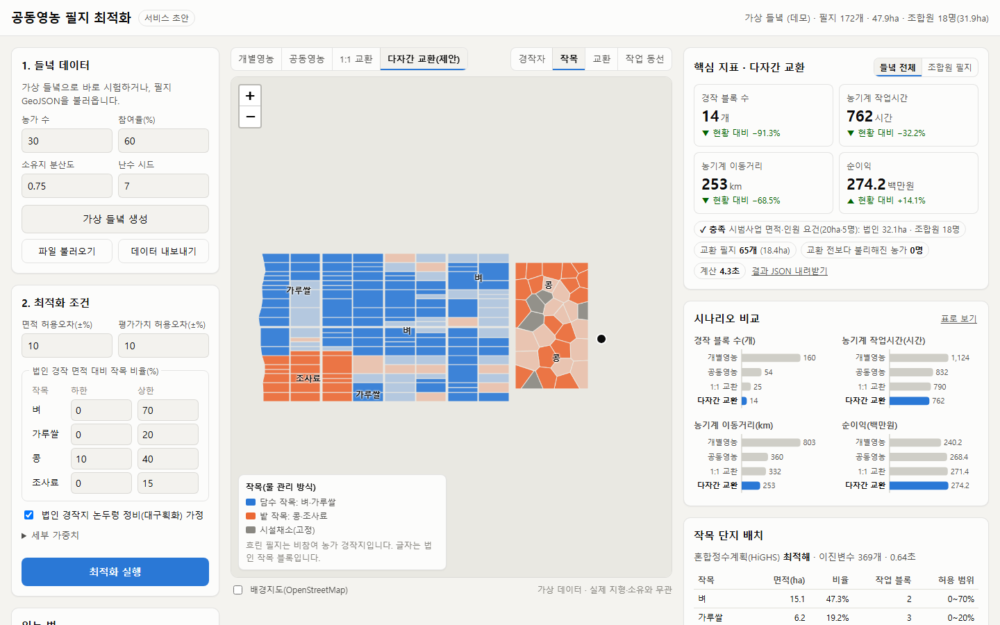
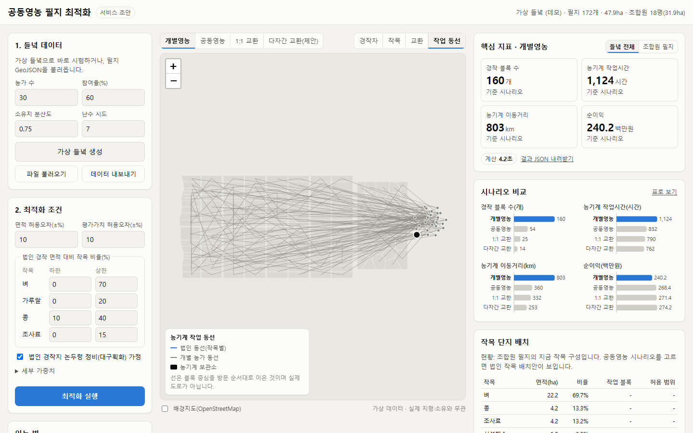
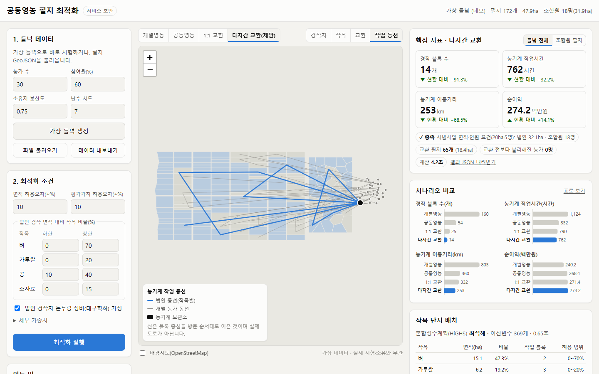

# 공동영농 필지 최적화 — 서비스 초안

공동영농 법인이 들녘 지도 위에서 세 가지를 함께 설계하도록 돕는 웹 서비스 초안이다(한동대 × 포스텍 해커톤 R4).

- **경작권 교환**: 이웃 농가와 필지를 맞바꿔 경작지를 한 덩어리로 모은다. 교환 전보다 불리해지는 농가는 없게 한다.
- **작목 단지 배치**: 법인 땅에 벼·가루쌀·콩·조사료를 단지로 배치한다. 담수 작목과 밭 작목이 맞닿지 않게 한다.
- **수익 배분**: 배분 기준별로 조합원 각자가 개별영농보다 나아지는지 비교한다.

기획 내용(초록·문제·선행·방법론·데이터·산출물)은 [docs/service-plan.md](docs/service-plan.md)에 있다.



| 개별영농(현황)의 농기계 동선 | 다자간 교환 후 법인 동선 |
|---|---|
|  |  |

> 화면의 들녘은 합성 데이터(가상 들녘)다. 실제 필지·소유자와 무관하다. 작목 소득·기계 비용 같은 파라미터도 초안 가정값이다.

## 실행

Python 3.10 이상이 필요하다. 추가 GIS 라이브러리는 쓰지 않는다.

```bash
python -m pip install -r requirements.txt
python -m server            # http://127.0.0.1:8000 을 브라우저로 연다
```

페이지를 열면 가상 들녘을 만들고 최적화까지 자동으로 돌린다. 약 4초 걸린다.
지도 라이브러리(Leaflet)는 CDN에서 받으므로 인터넷 연결이 필요하다.

명령줄에서 결과표만 볼 수도 있다.

```bash
python -m server.cli --seed 7
python -m server.cli --scenario my_field.json --out out/result.json
```

테스트는 다음 명령으로 돌린다.

```bash
python -m pytest
```

## 화면 쓰는 법

1. 왼쪽 **들녘 데이터**에서 가상 들녘을 만들거나 GeoJSON을 불러온다.
2. **최적화 조건**을 고르고 **최적화 실행**을 누른다.
3. 지도 위 버튼으로 시나리오를 바꾼다.
   - **개별영농**: 지금처럼 농가마다 자기 필지를 따로 짓는다.
   - **공동영농**: 조합원 필지를 법인이 짓는다. 교환은 없다.
   - **1:1 교환**: 두 경작자가 서로 이득일 때만 필지를 맞바꾼다.
   - **다자간 교환(제안)**: 플랫폼이 여러 경작자의 교환을 한꺼번에 설계한다.
4. 보기를 바꾼다. **경작자, 작목, 교환, 작업 동선** 네 가지가 있다.
5. 오른쪽 카드에서 지표, 시나리오 비교, 작목 배치, 교환 내역, 수익 배분을 본다.

시연할 때는 주소에 화면 상태를 넣을 수 있다.

```
http://127.0.0.1:8000/?scenario=S3&view=crop          # 다자간 교환안의 작목 배치
http://127.0.0.1:8000/?scenario=S0&view=route         # 현황의 농기계 동선
http://127.0.0.1:8000/?scenario=S3&rule=area&tables=1 # 면적 비례 배분과 표 보기
http://127.0.0.1:8000/?theme=dark                      # 어두운 테마
http://127.0.0.1:8000/?noauto                          # 자동 최적화 끄기
```

## 구조

```
server/
  main.py       FastAPI 앱(/api/* 와 웹 화면 제공)
  pipeline.py   현황 진단 → 공동영농 → 1:1 교환 → 다자간 교환 → 작목 배치 → 평가 → 수익 배분
  exchange.py   경작권 교환: 1:1 상호이익 교환(기준선), 다자간 교환(담금질 기법)
  zoning.py     작목 단지화 혼합정수계획(SciPy HiGHS)
  metrics.py    블록, 농기계 작업시간·이동거리, 순회 관리, 소득·임차료 정산
  sharing.py    수익 배분 4가지 기준(샤플리 값 몬테카를로 근사 포함)
  geo.py        좌표 변환, 면적, 필지 인접 판정(numpy)
  model.py      시나리오 JSON ↔ 내부 모델, 입력 검증
  demo.py       가상 들녘 생성기
  params.py     작목 소득·직불금·기계 비용 등 파라미터(초안 가정값)
  cli.py        명령줄 비교 도구
web/            화면(HTML·CSS·JS, 빌드 과정 없음)
tests/          pytest 21개
docs/           기획 문서와 화면 이미지
```

## API

| 메서드 | 경로 | 설명 |
|---|---|---|
| GET | `/api/health` | 서버 상태 |
| GET | `/api/defaults` | 기본 설정과 파라미터 |
| POST | `/api/scenario/demo` | 가상 들녘 생성. 본문 예: `{"seed": 7, "n_farmers": 30, "participation": 0.6, "fragmentation": 0.75}` |
| POST | `/api/scenario/import` | GeoJSON 또는 시나리오 JSON 검증, 인접 관계 계산 |
| POST | `/api/optimize` | `{"scenario": …, "settings": …}` → 네 시나리오 결과와 수익 배분 |

서버를 켠 뒤 `http://127.0.0.1:8000/docs`에서 요청 형식을 바로 시험할 수 있다.

## 실제 들녘 데이터 넣기

필지 경계는 EPSG:4326 GeoJSON으로 준비한다. 연속지적도나 팜맵에서 받아 QGIS로 잘라 내면 된다.
필지마다 `owner`가 반드시 있어야 한다. 나머지 속성(`land_type`, `soil_grade`, `drainage`, `land_value` 등)과 조합원 정보 형식은 [기획 문서 5.2절](docs/service-plan.md#52-입력-형식)에 있다.
화면의 **데이터 내보내기**로 받은 가상 들녘 JSON을 서식 예시로 쓰면 편하다.

파라미터는 모두 [server/params.py](server/params.py)에 있다. 농촌진흥청 소득자료나 실제 기계 비용으로 바꾸면 계산과 화면에 바로 반영된다.

## 알려진 한계

- 가상 들녘과 파라미터는 시연용 가정이다. 실제 들녘 검증 전에는 결과 수치를 정책 근거로 쓰지 않는다.
- 동선은 블록 중심을 방문 순서대로 이은 근사다. 실제 도로망을 쓰지 않는다.
- 하계 작목 한 작기만 배치한다. 이모작, 작업 일정, 소유권 교환 절차는 다음 단계다.
