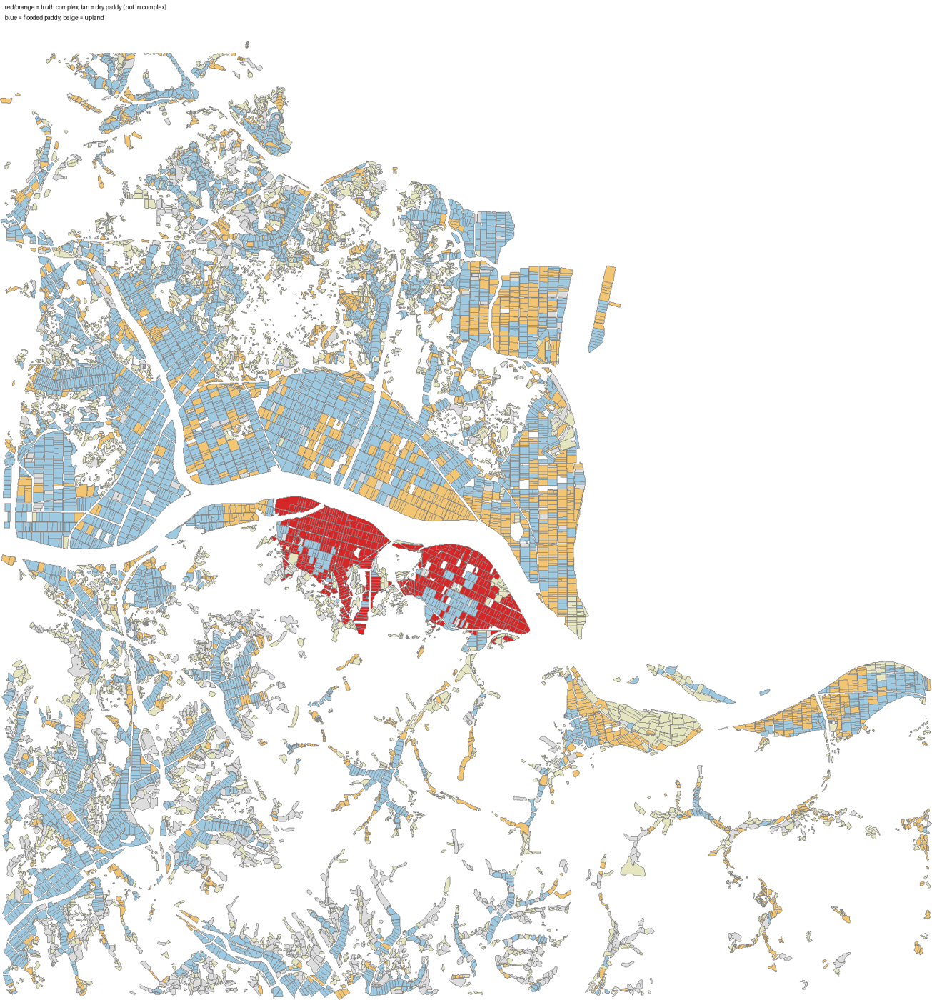
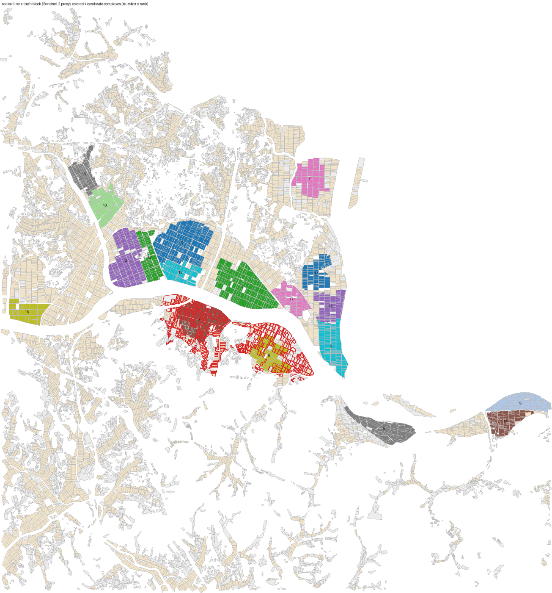

# 실측 검증 2 — 상주 함창읍(끌리네영농조합법인) 단지 재현

두 번째 정답 지역이다(2026-11-05). 방법은 [문경 영순 검증](validation-yeongsun.md)과 같다.

## 1. 지구 정보와 정답 라벨

| 항목 | 값 |
|---|---|
| 지구 | 상주 함창지구, 102ha·51호, 콩/양파·감자 이모작. 2024년 혁신농업타운 최종사업자 끌리네영농조합법인(대표 김부근), 사업장 함창읍 신흥3길 35(신흥리). 2024년부터 이모작 수익, 2025년 7월 첫 배당 (경북매일 2024.7.15·2025.7.2, 경북도민일보 2025.7.2) |
| 지도 | 함창읍 전체 + 300m, 팜맵 필지 14,093개, 2,652ha(논 5,966개 1,602ha). `data/regions/hamchang.json` |
| 속성 한계 | 흙토람은 하루 한도 때문에 PNU 11,430개 중 80개만 조회. 필지 10,037개가 배수 '보통'으로 들어가 배수 동질성(C8)이 사실상 꺼져 있음. OSM 도로·연속지적도는 네트워크 차단으로 빠짐 |
| 정답 신호 | Sentinel-2 2024-06-10(구름 1.9%)·2025-06-05(7.5%) MNDWI 중앙값 < −0.3인 논(두 해 모두 모내기철에 물 없음) + 지목 답·팜맵 밭 판독 필지 |
| 덩어리 | 30m 간격 연결 뒤 4개(132·89·47·30ha). 법인 소재지 **신흥리가 면적의 절반 이상인 덩어리만** 남김 → **1개, 131.6ha, 546필지(신흥리 112.9·신덕리 19.0)** |

신흥리에는 2017년부터 콩·밀을 짓던 나누리·담꽃새 영농조합도 있다. 132ha 덩어리에는 그 땅이 섞여 있을 수 있어 보도 면적(102ha)보다 크다.
"2023년엔 담수였던 논"만 남기는 변화 조건을 걸면 덩어리가 27ha(태봉리)로 줄어든다. 신흥리 논이 2024년 전부터 밭작물을 지었다는 뜻이라, 이 지구에서는 변화 조건을 쓰지 않았다.



## 2. 재현 검증 결과 (20~60ha, 농가 5명 이상(필지 수 추정), 경사 7% 이하, 도로 접속 필수)

| 방법 | F1 | 정밀도 | 재현율 | 면적 IoU | 제약 충족 |
|---|---|---|---|---|---|
| **제안(제약 최적화)** | 0.17 | 0.11 | 0.33 | 0.27 | **18 / 18** |
| 공간 KMeans | 0.14 | 0.07 | 0.85 | 0.41 | 0 / 18 |
| 면적순 greedy | 0.20 | 0.13 | 0.48 | 0.15 | 12 / 33 |

순위 적중: 후보 18곳 중 **4위 단지(42.3ha)의 87%가 정답 안**이고 정답의 28%를 덮는다. 6위(30.4ha)가 12%를 더 덮어 상위 10개 누적 40%.
면적 상한을 150ha로 올려도 결과는 같다(성장이 형상 기준에서 멈춘다).
민감도: Jaccard 평균 0.89, 최소 0.67.



## 3. 실제 단지가 우리 기준을 어기는 곳

| 제약 | 우리 기준 | 실제 단지 | 판정 |
|---|---|---|---|
| C2 면적 | 20~60ha | 131.6ha | 위반(상한) |
| C6 경사 | ≤7% | 평균 2.2%, 필지 83개가 10~24%(DEM 잡음 추정) | 필지 단위 제외 |
| C7 형상지수 | ≥0.20 | **0.02** | 위반 |
| C8 배수 동질성 | ≥0.60 | 1.00 (토양 자료가 '보통' 일괄이라 의미 없음) | 판정 불가 |

기준 완화 실험: 형상 0.1이면 같은 후보가 57.6ha로 커져 정답의 36%, 상위 10개 누적 66%. 형상 0.05·면적 150·배수 0.4이면 69.4ha, 38%, 누적 74%.

## 4. 두 지역을 합쳐 보면

| | 문경 영순(늘봄) | 상주 함창(끌리네) |
|---|---|---|
| 정답 덩어리 | 65.7ha(보도 105~140) | 131.6ha(보도 102) |
| 적중 순위 | 2위 / 5곳 | 4위 / 18곳 |
| 적중 단지의 정답 안 비율 | 98% | 87% |
| 정답을 덮는 비율(상위 10) | 49% | 40% |
| 실제 단지 형상지수 | 0.03 | 0.02 |
| 형상 0.1로 완화 시 덮는 비율 | 62% | 66% |

두 곳 모두 실제 단지는 강·수로를 따라 길게 이어진 띠 모양이라 형상지수가 0.03 이하다. 우리 기준 0.2는 현장보다 한 자릿수 엄격하고, 이것이 재현율을 막는 첫 번째 병목이다.
두 곳 모두 "우리 후보가 정답 안에 있는가"(87~98%)는 높고 "정답을 다 덮는가"(40~49%)는 낮다. 즉 엔진은 맞는 자리를 고르지만 작게 자른다.

## 5. 다시 만들기

```bash
python -m server.realdata.build --farmmap-shp data/raw/farmmap/2025_경상북도_상주시.shp --addr 함창읍 \
  --name "상주시 함창읍 들녘" --out data/regions/hamchang.json
python -m server.realdata.truth_s2 data/regions/hamchang.json --dates 2024-06-10 2025-06-05 --ndwi -0.3 \
  --min-ha 30 --max-ha 300 --village 신흥리 --png out/hamchang_truth.png --csv out/hamchang_s2.csv
python -m server.realdata.report_truth data/regions/hamchang.json --png out/hamchang_eval.png --json out/hamchang_eval.json
```
