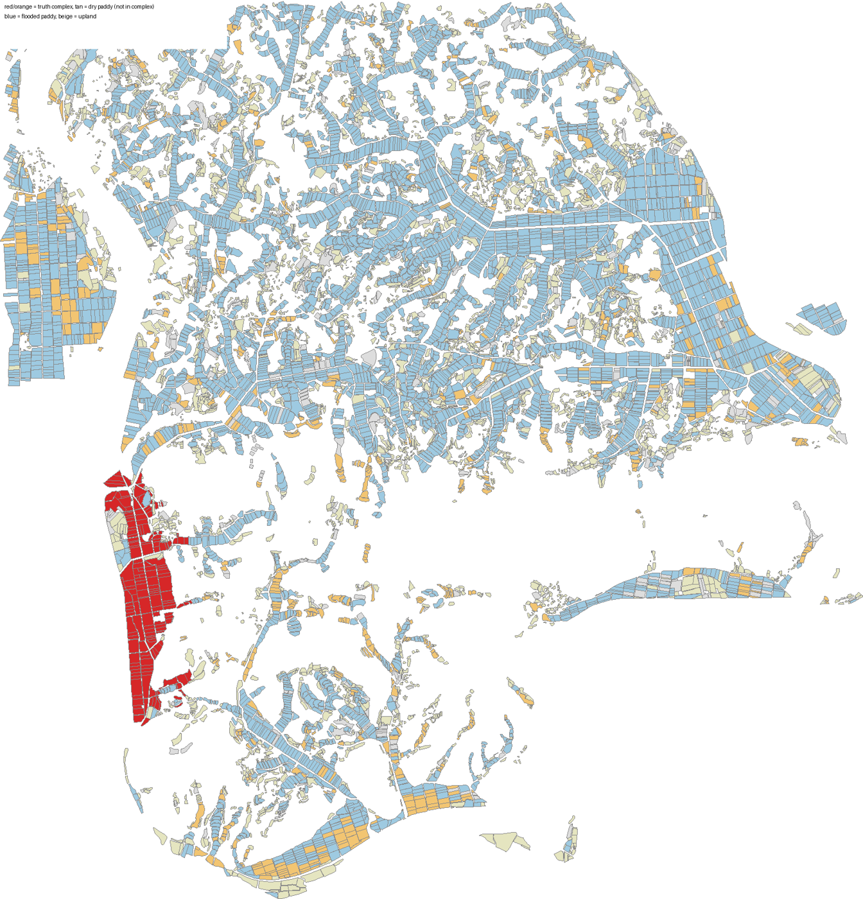
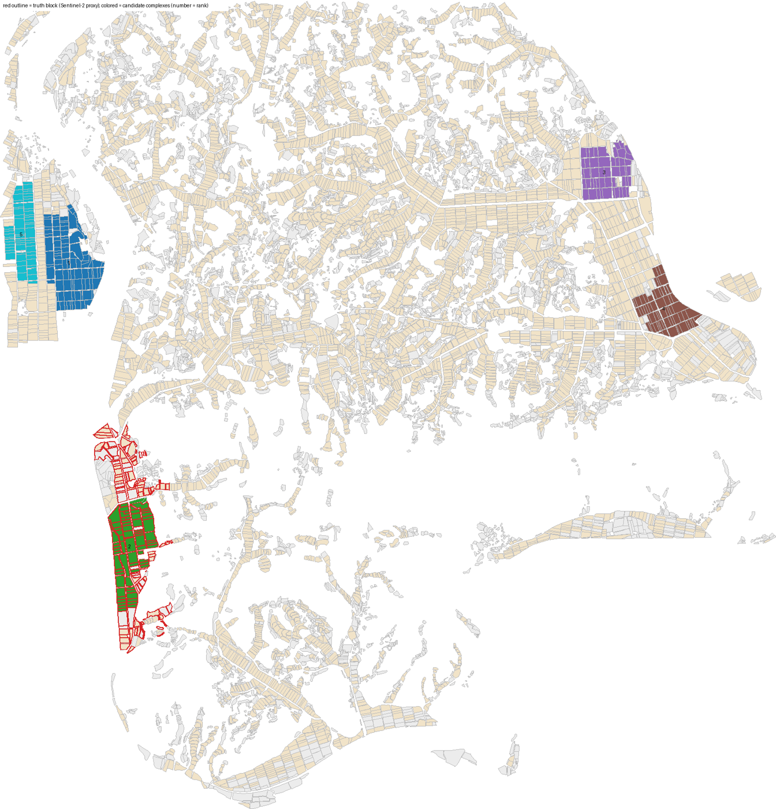

# 실측 검증 — 문경 영순면(늘봄영농조합법인) 단지 재현

후보단지 시뮬레이터가 실제 공동영농 단지를 찾아내는지, 실제 지역에서 처음 확인한 결과다(2026-11-05).
정답 경계는 공개되지 않아 위성영상으로 근사했다. 그래서 아래 숫자는 "정답과의 일치율"이 아니라 "작목 전환 구역과의 일치율"이다.

## 1. 지도와 정답 라벨

| 항목 | 값 |
|---|---|
| 지도 | 문경시 영순면 전체 + 300m, 팜맵 필지 9,952개, 1,723ha (논 4,975개 1,185ha). `data/regions/yeongsun.json` |
| 속성 출처 | 팜맵(경계·분류·지목·경지정리), Copernicus DEM(경사), 흙토람(배수·적성, PNU 8,090개 중 900개 직접 조회, 나머지 300m 이웃값). OSM 도로·연속지적도는 네트워크 차단으로 빠짐 → 도로 접속은 경지정리 필지(17%)로만 판정 |
| 정답 신호 ① | Sentinel-2 2023-06-06(구름 4.7%) MNDWI < −0.3인 논 = 모내기철에 물이 없는 논 580개 111ha |
| 정답 신호 ② | 지목은 답인데 팜맵(2024년 영상)이 밭으로 판독한 필지 740개 140ha = 밭작물로 바뀐 논 |
| 정답 덩어리 | ①∪②를 30m 간격으로 잇고 구멍을 메운 뒤 40~250ha 덩어리: **1개, 65.7ha, 184필지(율곡리 113·의곡리 71)** |

보도된 늘봄 면적은 105~140ha다. 위성으로 잡힌 덩어리는 그 절반 남짓이다. 차이는 2023년 이후 확장분, 면 경계 밖 필지, 팜맵이 여전히 논으로 판독한 필지가 섞인 결과로 본다. 라벨은 추정값이므로 항공사진과 대조가 필요하다.



## 2. 재현 검증 결과 (기본 조건: 20~60ha, 농가 5명 이상(필지 수 추정), 경사 7% 이하, 도로 접속 필수)

| 방법 | F1 | 정밀도 | 재현율 | 면적 IoU | 제약 충족 |
|---|---|---|---|---|---|
| **제안(제약 최적화)** | **0.26** | 0.20 | 0.37 | **0.48** | **5 / 5** |
| 공간 KMeans | 0.07 | 0.04 | 0.86 | 0.23 | 0 / 5 |
| 면적순 greedy | 0.18 | 0.12 | 0.45 | 0.29 | 2 / 12 |

순위 적중: 후보 5곳 중 **2위 단지(32.8ha)의 98%가 정답 덩어리 안**에 있고, 정답의 49%를 덮는다. 1위 단지는 면 서쪽 왕태리 경지정리 블록이다.
민감도: 조건을 ±20% 흔들었을 때 선정 필지 Jaccard 평균 0.88, 최소 0.60(A_min +20%).



## 3. 실제 단지가 우리 기준을 어기는 곳

정답 덩어리 184필지를 그대로 하나의 단지로 놓고 제약을 검사했다.

| 제약 | 우리 기준 | 실제 단지 | 판정 |
|---|---|---|---|
| C2 면적 | 20~60ha | 65.7ha | 위반(상한) |
| C3 참여 농가 | ≥5 | 추정 74 | 충족 |
| C5 도로 접속 | ≥1 | 88필지 | 충족 |
| C6 경사 | ≤7% | 평균 2.1%, 필지 3개가 11~45%(강변 DEM 잡음 추정) | 필지 단위 제외 |
| C7 형상지수 | ≥0.20 | **0.03** | 위반 |
| C8 배수 동질성 | ≥0.60 | **0.50**(양호 47·보통 78·불량 59) | 위반 |

실제 단지는 강을 따라 길게 늘어선 띠 모양이고, 배수 등급이 섞여 있다. 우리 형상·배수 기준은 실제 법인이 만든 단지보다 엄격하다.
형상 기준을 0.2에서 0.1로 낮추면 같은 후보가 42.3ha로 커져 정답의 62%를 덮는다. 마찰 가중치(0.25~1.0)와 배수 기준(0.4~0.6)은 결과를 거의 바꾸지 않았다.

## 4. 읽는 법과 한계

- KMeans는 재현율 0.86이지만 만든 단지가 하나도 제약을 지키지 못한다. 제안 방법의 강점은 정확도가 아니라 "규칙을 지키는 후보를 낸다"는 점이다.
- 정답이 한 곳(n=1)이라 일반화할 수 없다. 상주 함창·경주 안강·의성 단북을 같은 방법으로 추가해야 한다.
- 도로 접속이 경지정리 필지로만 판정돼 후보 수가 5곳에 그쳤다. OSM 도로가 들어가면 후보가 늘고 순위가 바뀔 수 있다.
- 흙토람은 11%만 직접 조회했다. 배수 동질성 수치는 이웃 보간값에 크게 기대고 있다.

## 5. 다시 만들기

```bash
python -m server.realdata.build --farmmap-shp data/raw/farmmap/2025_경상북도_문경시.shp --addr 영순면 \
  --name "문경시 영순면 들녘" --out data/regions/yeongsun.json
python -m server.realdata.truth_s2 data/regions/yeongsun.json --dates 2023-06-06 --ndwi -0.3 \
  --min-ha 40 --max-ha 250 --png out/yeongsun_truth.png --csv out/yeongsun_s2.csv
python -m server.realdata.report_truth data/regions/yeongsun.json --png out/yeongsun_eval.png --json out/yeongsun_eval.json
```
