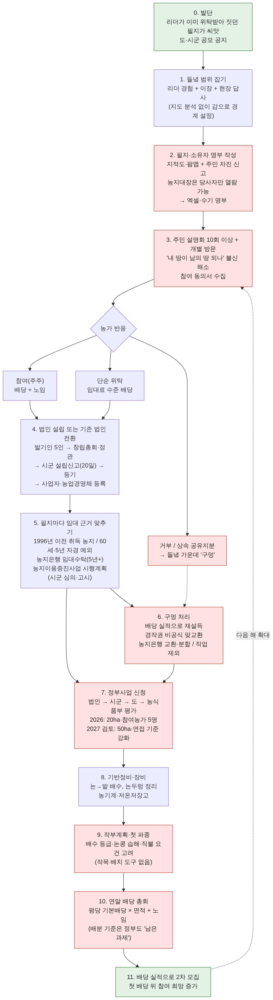
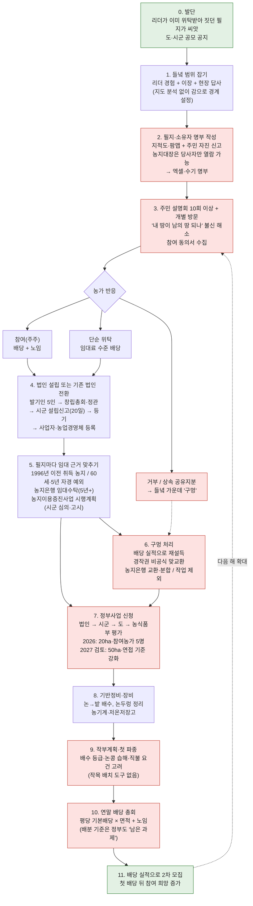

# 공동영농법인의 필지 집적 파이프라인 (서비스 없이 하는 현재 방식)

조사 노트(`research_notes/공동영농법인 조직과 필지 집적 과정/`)를 바탕으로 그렸다. 2026-10-31 기준이다.

빨간 칸은 공개 자료에서 어려움이 확인되거나 도구가 없는 단계다. 점선은 보도 근거가 없는 추론이다.

## 단계별 근거와 기간

| 단계 | 현재 하는 일 | 확인된 어려움 |
|---|---|---|
| 0~1 범위 잡기 | 리더의 기존 위탁 필지와 신뢰 관계에서 출발한다 | 시범지는 이미 집적이 진행된 들녘이 선택된 경향이 있다 |
| 2 명부 | 주민 신고와 동의서 첨부 서류로 엑셀 명부를 만든다 | 법인이 들녘 전체 소유자를 일괄 조회할 법적 경로가 없다 |
| 3 설명회 | 10회 이상 반복한다(문경, 영덕) | 초기 불신. 첫 배당 전에는 믿지 않는다 |
| 5 임대 근거 | 필지별로 농지법 예외 사유를 맞춘다 | 2025년부터 법인 단독 농지이용증진사업이 가능해졌다 |
| 6 구멍 | 설득, 비공식 교환, 제외 | 해결 사례가 공개된 적 없다. 80ha 넘는 법인도 필지가 흩어져 있다 |
| 7 신청 | 시군·도·농식품부 3단계 추천과 평가 | 2027년부터 50ha와 연접 기준 상향이 검토 중이다 |
| 9 작부 | 배수·습해·직불 요건을 경험으로 판단한다 | 공개 도구는 팜맵 면적 계산뿐이다 |
| 10 배분 | 면적 단일 단가 배당 + 노임 | 농식품부 협의체가 '투명한 배분 기준'을 남은 과제로 꼽았다 |

| 사례 | 기간 |
|---|---|
| 문경 영순 | 법인 설립 2023-01 → 첫 파종 2023-06 → 첫 배당 2023-12 |
| 영덕 달산 | 시작 2024-06 → 첫 배당 2024-12 |
| 신규 단지 일반 | 설명회부터 첫 배당까지 약 1~1.5년 |
